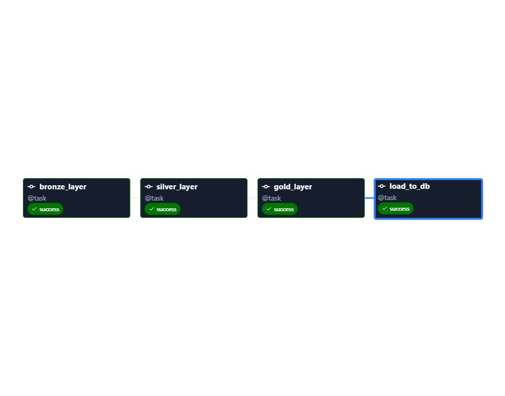
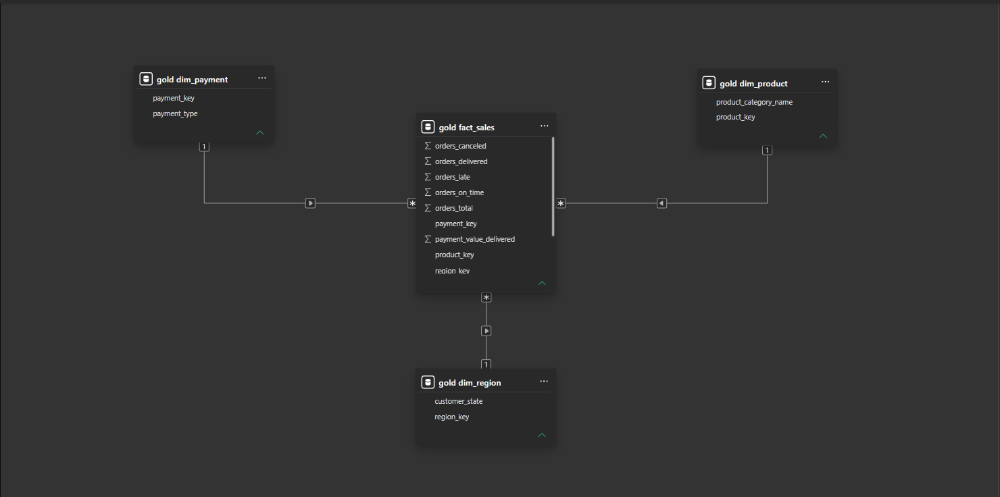
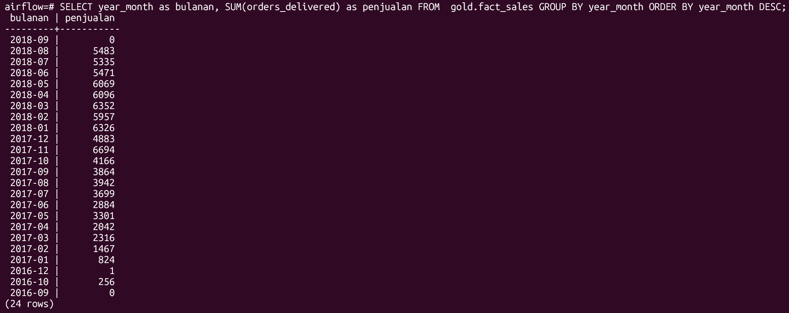
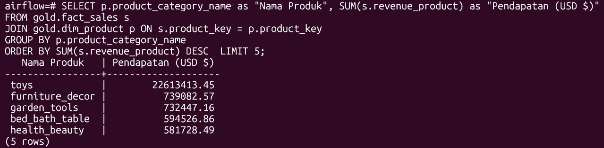
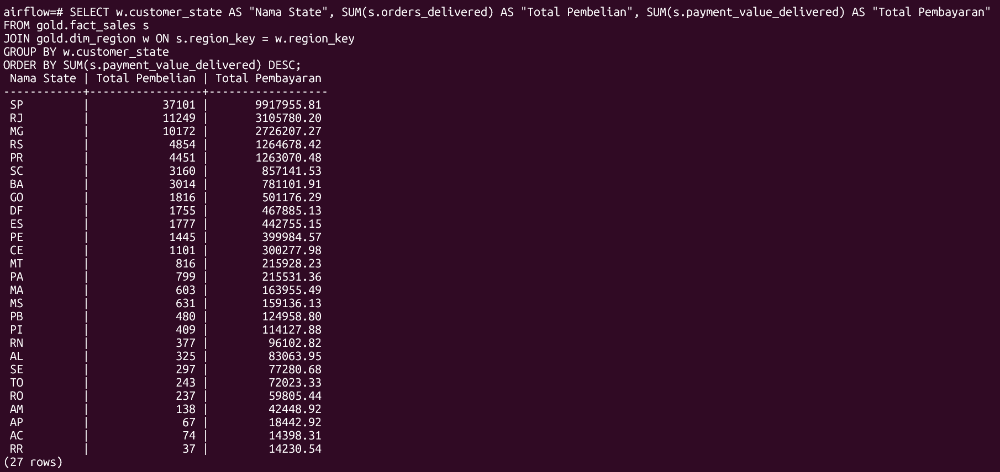
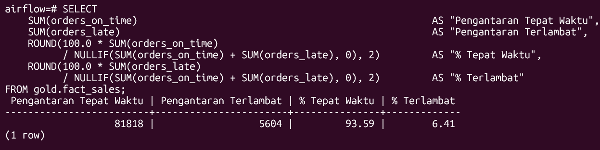
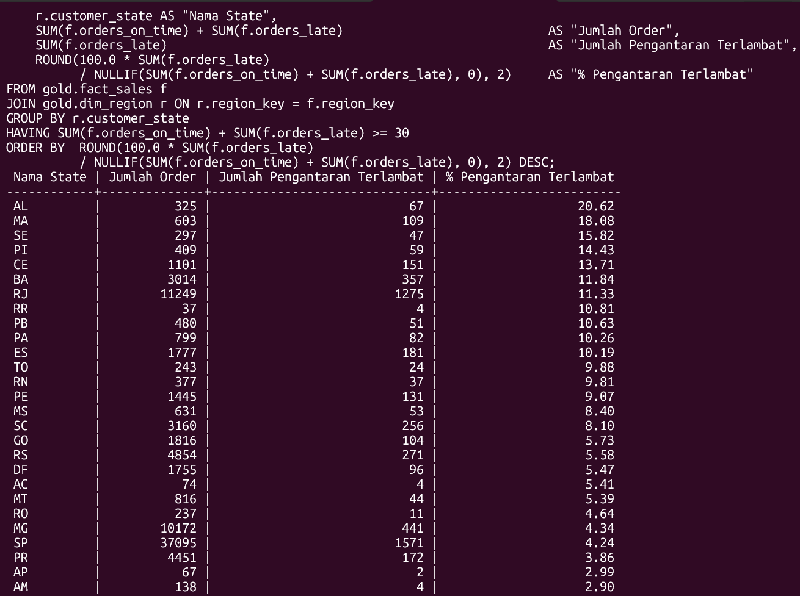
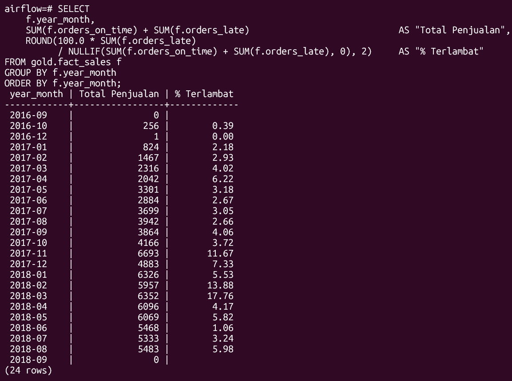
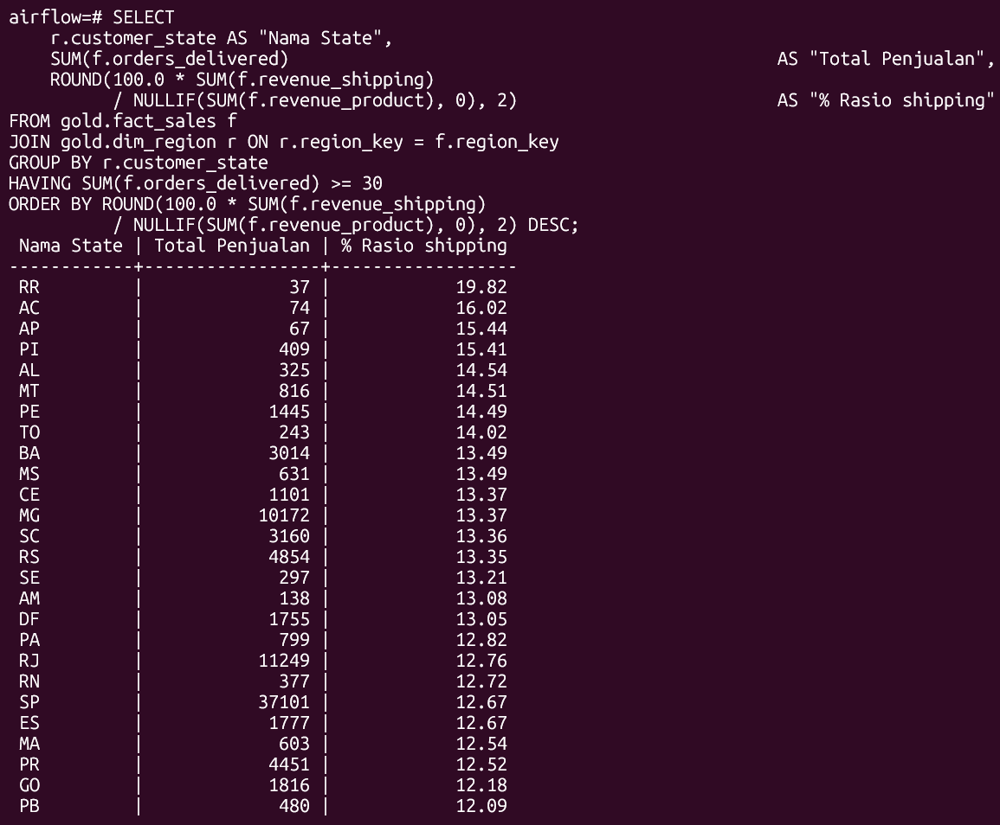

# E-Commerce (E-Commerce ETL)

> An e-commerce data pipeline built using a medallion architecture (Bronze, Silver, and Gold) to answer business questions based on transaction data, using Python, Apache Airflow, and PostgreSQL.

## Table of Contents

- [About the Project](#about-the-project)
- [Objectives](#objectives)
- [Project Outputs](#project-outputs)
- [Architecture](#architecture)
- [Technology Stack](#technology-stack)
- [Folder Structure](#folder-structure)
- [Data Sources](#data-sources)
- [Pipeline Details](#pipeline-details)
- [Data Model (Gold Layer)](#data-model-gold-layer)
- [Pipeline Workflow (Airflow)](#pipeline-workflow-airflow)
- [Getting Started](#getting-started)
- [Analysis and Findings](#analysis-and-findings)
- [Data Quality](#data-quality)
- [Limitations](#limitations)
- [Future Improvements](#future-improvements)
- [Author](#author)

## About the Project

E-commerce transaction data is distributed across five CSV files: orders, order items, payments, customers, and products. These separate datasets are difficult to analyze directly, contain missing values, and lack standardized metric definitions.

This project builds an automated ETL pipeline that cleans the data, quarantines problematic records, models the data into a star schema in PostgreSQL, and makes it available for SQL-based analysis to answer six business questions.

**Data Period:** September 2016 to September 2018 (based on purchase dates).

## Objectives

- Provide a consistent single source of truth for sales analysis.
- Automate ETL processes using Airflow.
- Establish standardized business metric definitions.
- Separate raw data, cleaned data, and analytics-ready data using a medallion architecture.

### Business Questions Addressed

1. What are the monthly order and revenue trends?
2. Which product categories generate the highest revenue?
3. Which regions contribute the most to overall sales?
4. How reliable is the delivery process (on-time vs. late)?
5. How significant are shipping costs compared to product prices?

## Project Outputs

| Output | Location | Description |
|---|---|---|
| Bronze tables | `/opt/airflow/data/bronze/` | Raw copies of the source data |
| Silver tables | `/opt/airflow/data/silver/` | `silver_transaction.csv`, `silver_products.csv`, and `quarantine_null_rows.csv` |
| Gold CSV files | `/opt/airflow/data/gold/` | `dim_region`, `dim_product`, `dim_payment`, `fact_sales` |
| PostgreSQL tables | `gold` schema | Star schema used as the source for SQL analysis |
| Analysis queries | `sql/` | Queries designed to answer six business questions (see [Analysis and Findings](#analysis-and-findings)) |

## Architecture

```text
Source (5 CSV Files)
   │ Extract
   ▼
BRONZE  → Raw Data
   │ Clean, standardize, quarantine nulls, and merge
   ▼
SILVER  → silver_transaction, silver_products, quarantine_null_rows
   │ Build star schema and calculate business metrics
   ▼
GOLD    → dim_region, dim_product, dim_payment, fact_sales
   │ Load
   ▼
PostgreSQL (gold schema) → SQL Analysis
```

<!-- Place the image in docs/images/etl_architecture.png -->


## Technology Stack

| Component | Technology |
|---|---|
| Programming Language | Python 3.11 |
| Data Processing | pandas |
| Orchestration | Apache Airflow 3.3.2 |
| Data Warehouse | PostgreSQL 15 |
| Environment | Docker / Docker Compose |
| Data Analysis | SQL (PostgreSQL) |

## Folder Structure

```text
ETLogistic/
├── dags/
│   └── orchestrator.py        # Airflow DAG definition
├── scripts/
│   ├── bronze_layer.py        # Data extraction
│   ├── Silver_layer.py        # Data transformation and quarantine
│   ├── gold_layer.py    # Star schema implementation
│   └── load_gold_to_db.py     # Load data into PostgreSQL
├── data/
│   ├── bronze/
│   ├── silver/
│   └── gold/
├── img/
│   └──*.png/jpg                # Architecture diagrams and query result screenshots
├── [docker-compose.yaml]
└── README.md
```

## Data Sources

| Table | Description | Key |
|---|---|---|
| `df_Orders` | Order status and dates | `order_id` |
| `df_OrderItems` | Products, sellers, prices, and shipping costs | `order_id` |
| `df_Payments` | Payment methods and values | `order_id` |
| `df_Customers` | Customer locations | `customer_id` |
| `df_Products` | Product categories | `product_id` |

**Data Characteristics:**

- `order_id` and `customer_id` are unique, meaning each order contains one item and one payment, with 1:1 relationships between the order-related tables.
- Since each `customer_id` is unique per order, repeat customer analysis (retention and Customer Lifetime Value/CLV) cannot be performed.
- The product table has a row count aligned with the order table and contains repeated `product_id` values (split columns rather than a normalized table). It must be deduplicated by `product_id` before joining to prevent transaction rows from being duplicated.
- Data source: https://www.kaggle.com/datasets/bytadit/ecommerce-order-dataset. Currency: USD.

## Pipeline Details

### Bronze Layer

Data is read directly from the five source files without modifying any values. Unnamed index columns (`Unnamed: 0`) are removed during the reading process.

### Silver Layer

- Unused columns are removed, including customer postal codes, installments, payment sequence numbers, product weight, and product dimensions.
- Rows containing null values are moved to **quarantine**, except for `order_approved_at` and `order_delivered_timestamp`, since missing values in these columns are expected for orders that have not been delivered or have been canceled.
- All quarantined rows are consolidated into a single file, `quarantine_null_rows.csv`, containing the source table, row key, missing column names, and original row data in JSON format.
- Duplicate keys are removed, data types are standardized, and orders, items, customers, and payments are merged into `silver_transaction` with 1:1 relationship validation.
- Orders that lose their corresponding records after quarantine (for example, when their item records are quarantined) are also quarantined to ensure that `silver_transaction` contains no null values.

### Gold Layer

- Three dimension tables (`dim_region`, `dim_product`, and `dim_payment`) are created with one row per unique value and assigned surrogate keys.
- `fact_sales` is built from `silver_transaction`, joined with product categories, and then aggregated.
- Built-in validation controls ensure that row counts remain unchanged after joins and that total orders and revenue in the fact table match the source data.

### Load

All Gold tables are cleared and reloaded within a single transaction using (`TRUNCATE` and `COPY`). This ensures that rerunning the pipeline does not duplicate data and that existing data remains intact if the loading process fails.

## Data Model (Gold Layer)

The data warehouse uses a star schema with the following grain: **month × state × product category × payment method**.

<!-- Place the image in docs/images/star_schema.png -->


| Table | Type | Description |
|---|---|---|
| `fact_sales` | Fact | Total orders, delivered orders, canceled orders, product revenue, shipping revenue, payment value, on-time orders, and late orders |
| `dim_region` | Dimension | Customer state |
| `dim_product` | Dimension | Product category |
| `dim_payment` | Dimension | Payment method |

The fact table only stores additive measures. Ratios are calculated at the query level by dividing aggregated values, rather than averaging individual ratios.

### Key Business Rules

- Revenue is only recognized from orders with a `delivered` status.
- Product revenue and shipping revenue are reported separately.
- Delivery performance is measured against the estimated delivery date at the day level, only for `delivered` orders with available delivery dates.
- The reporting period follows calendar months based on purchase dates.
- Missing values are not estimated; instead, affected records are quarantined and reported.

### Metric Definitions

| Metric | Formula |
|---|---|
| On-time delivery rate | `SUM(orders_on_time) / (SUM(orders_on_time) + SUM(orders_late))` |
| Late delivery rate | `SUM(orders_late) / (SUM(orders_on_time) + SUM(orders_late))` |
| Shipping cost ratio | `SUM(revenue_shipping) / SUM(revenue_product)` |
| Product revenue | `SUM(revenue_product)` (delivered orders) |
| Total payment value | `SUM(payment_value_delivered)` (delivered orders) |

## Pipeline Workflow (Airflow)

```text
silver_layer >> gold_layer >> data_quality >> gold_to_db
```

| Task | Function |
|---|---|
| `silver_layer` | Cleans, quarantines, and merges the data |
| `gold_layer` | Builds dimension and fact tables (`run_gold()`) |
| `data_quality` | [Data quality checks] |
| `gold_to_db` | Loads Gold CSV files into PostgreSQL |

## Getting Started

### Prerequisites

- Docker and Docker Compose.
- Airflow connection `postgres_default` must be configured.
- Source files must be placed in `data/bronze/`.
- Access to PostgreSQL (for example, through `psql`) to execute analysis queries.

### Installation and Execution

```bash
# 1. Clone the repository
git clone [repository-url]
cd [project-folder-name]

# 2. Start the services
docker compose up -d

# 3. Open the Airflow UI
# http://localhost:[port]

# 4. Enable and trigger the DAG: [dag_name]

# 5. Execute analysis queries in PostgreSQL
docker compose [posgres_container] psql -U [user] -d [database]
```

## Analysis and Findings

The analysis is performed using SQL queries directly against the `gold` schema. Each section below presents the findings and, optionally, screenshots of the query results.

### 1. Monthly Order and Revenue Trends

<!-- docs/images/q1_trend.png -->


The number of delivered orders increased from 824 in January 2017 to 6,694 in November 2017, while product revenue rose from approximately $231,000 to $2.81 million. Starting in January 2018, monthly order volume remained relatively stable between 5,300 and 6,400 orders. Revenue from June to August 2018 ($1.68 million to $1.74 million) was lower than from March to May 2018 ($2.17 million to $2.37 million). September 2016, October to December 2016, and September 2018 contain incomplete data and are therefore excluded from trend analysis.


### 2. Product Categories with the Highest Revenue

<!-- docs/images/q2_category.png -->


The top five product categories by revenue are: `toys` (approximately $22.6 million), `furniture_decor` ($739,000), `garden_tools` ($732,000), `bed_bath_table` ($595,000), and `health_beauty` ($582,000).

[Add percentage contribution analysis and interpretation.]

### 3. Regions with the Highest Contributions

<!-- docs/images/q3_region.png -->


The market is highly concentrated. SP accounts for 37,101 delivered orders (approximately 42.4% of 87,428 orders) and total payments of approximately $9.92 million (around 42.2%). The three leading states (SP, RJ, and MG) collectively contribute approximately 66.9% of orders and 67.0% of total payments. RS and PR each account for approximately 5% of orders. The smallest states by order volume are RR (37 orders), AP (67 orders), and AC (74 orders). The metric used is orders per region rather than the number of customers, since each customer appears in only one order.

### 4. Delivery Reliability

<!-- docs/images/q4_delivery.png -->


87,422 delivered orders with measurable delivery performance, 81,818 (93.59%) arrived on time, while 5,604 (6.41%) were delayed.



- **By state:** The highest late delivery rates occurred in AL (20.62%), MA (18.08%), SE (15.82%), PI (14.43%), and CE (13.71%), all located in northeastern Brazil. SP (4.24%), MG (4.34%), and PR (3.86%) had among the lowest rates. In terms of volume, SP (1,571) and RJ (1,275) recorded the highest numbers of delayed orders. RJ also had a relatively high late delivery rate (11.33%) despite its large order volume.


- **By month:** The late delivery rate ranged from 2.18% to 6.22% between January and October 2017, before increasing to 11.67% in November 2017 (coinciding with the peak in order volume). It then reached 13.88% in February 2018 and 17.76% in March 2018, when order volume was not experiencing a similar surge. In June 2018, the rate dropped to 1.06%.

### 5. Shipping Costs Relative to Product Prices

<!-- docs/images/q5_shipping.png -->


The shipping cost ratio (shipping costs divided by product prices) across states with at least 30 orders ranged from approximately 12% to 19.8%. SP, the largest market, recorded a ratio of 12.67%. The highest ratios were found in smaller states such as RR (19.82%, 37 orders), AC (16.02%), and AP (15.44%), as well as medium-volume states such as PI (15.41%), AL (14.54%), MT (14.51%), and PE (14.49%). AL and PI also rank among the states with the highest late delivery rates, making them worth further investigation.


### Summary of Findings

| Area | Findings |
|---|---|
| Growth | Order volume increased from 824 orders (Jan 2017) to a peak of 6,694 (Nov 2017), then stabilized between 5,300 and 6,400 orders per month. |
| Delivery | 93.59% of orders were delivered on time; late deliveries were concentrated in AL, MA, SE, PI, and CE. |
| Market Concentration | SP accounts for approximately 42% of orders, while SP, RJ, and MG collectively account for approximately 67%. |
| Shipping Costs | The shipping cost ratio is 12.67% in SP and approximately 14% to 20% in smaller and medium-volume states. |

## Data Quality

- Rows containing null values are quarantined in `quarantine_null_rows.csv` and can be traced back to their respective source tables.
- Latest pipeline run results: 38279 row from orders and 476 row from products. Can check ini log files silver layer.
- Relationships between orders, items, customers, and payments are validated as 1:1 during the merging process. Any violations cause the pipeline to fail.
- In PostgreSQL, primary key, unique, and foreign key constraints maintain the integrity of dimension and fact tables, while the composite primary key in `fact_sales` enforces its defined grain.

## Limitations

- There is no customer identifier available across multiple orders, so customer retention and repeat customer analysis cannot be performed.
- Product weight and dimensions are not used, preventing analysis of the relationship between product weight and shipping costs.
- The fact table is aggregated by month, state, product category, and payment method. Therefore, order-level details and delivery delay severity (1–3, 4–7, and more than 7 days) are not available.
- Installment information is not included in the fact table, limiting payment analysis to payment methods.
- The first and last months of the dataset contain incomplete data and must be excluded from trend analysis.
- Rows containing null values are quarantined and excluded from analytical results.
- No dashboard has been implemented; analytical results are presented through SQL queries and written summaries.

## Future Improvements

- [ ] Add a `dim_date` dimension table.
- [ ] Implement incremental data loading.
- [ ] Add pipeline failure notifications.
- [ ] Include delivery delay severity in the fact table.
- [ ] Develop a visualization dashboard (optional).